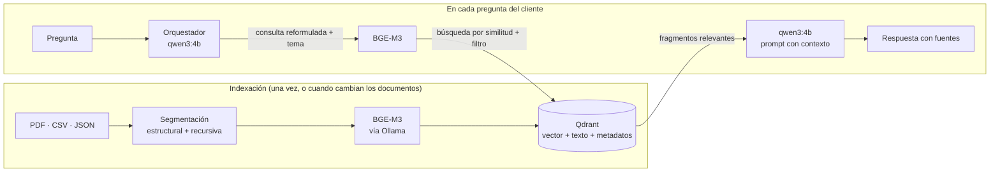

# Fase 1: Selección de componentes clave del sistema RAG

## Resumen de la decisión

| Componente | Elección | Alternativa considerada |
|---|---|---|
| Modelo de embeddings | **BGE-M3** (BAAI, código abierto, servido localmente con Ollama) | OpenAI `text-embedding-3-small` |
| Base de datos vectorial | **Qdrant** (código abierto; modo local en el prototipo, servidor o Qdrant Cloud en producción) | Pinecone |
| Framework | **LangChain** | LlamaIndex |
| Modelo de generación | `qwen3:4b` en Ollama (el mismo del Taller 1) | — |

Evaluamos dos combinaciones completas:

- **A. OpenAI `text-embedding-3-small` + Pinecone**: todo administrado en la nube, cero infraestructura.
- **B. BGE-M3 + Qdrant**: todo de código abierto, desplegable en la infraestructura propia. **← Elegida**

La razón de fondo es la coherencia con la arquitectura del Taller 1: allí decidimos usar modelos open-source desplegados localmente para que los datos de los clientes no salgan de EcoMarket. Usar un servicio externo solo para los embeddings rompería esa decisión, porque **cada pregunta del cliente** (que puede incluir nombres, direcciones o números de pedido) se enviaría a un tercero para vectorizarla.

## 1. Cómo impacta cada componente en la eficacia del RAG

Antes de comparar opciones conviene tener claro qué se juega en cada pieza:

- **El modelo de embeddings decide qué se recupera.** Si dos textos que significan lo mismo ("¿me devuelven la plata?" y "el reembolso se hace al mismo medio de pago") no quedan cerca en el espacio vectorial, el fragmento correcto nunca llega al prompt, y ni el mejor LLM puede responder bien. Un error aquí se convierte en una respuesta de "no tengo información" o, peor, en una respuesta basada en el fragmento equivocado. En español esto es crítico: un modelo entrenado sobre todo en inglés puede representar mal regionalismos ("plata" por dinero, "pitillo" por pajilla) o errores de ortografía frecuentes en un chat.
- **La base vectorial decide qué tan rápido y con qué precisión se busca.** Además de la búsqueda por similitud, importa poder **filtrar por metadatos** (por ejemplo, buscar solo en la política de garantías), hacer **búsqueda híbrida** (semántica + palabras clave, útil para códigos como "ECO-10005" o "IPX4") y escalar sin reescribir el sistema.
- **Ambas decisiones son difíciles de revertir.** Cambiar de modelo de embeddings obliga a revectorizar toda la base, porque los vectores de modelos distintos no son comparables. Cambiar de base vectorial obliga a migrar los datos y, si es un servicio propietario, a reescribir las consultas.

## 2. Modelo de embeddings

### Criterios

1. **Calidad en español**, incluyendo lenguaje informal de chat.
2. **Costo** a la escala de EcoMarket.
3. **Privacidad** de los datos que se vectorizan.
4. **Operación**: quién lo mantiene y qué recursos necesita.
5. **Capacidades de búsqueda** (densa, dispersa/híbrida) y longitud máxima de entrada.

### Opciones evaluadas

| Modelo | Tipo | Idiomas | Dimensiones | Entrada máx. | Costo | Búsqueda |
|---|---|---|---|---|---|---|
| OpenAI `text-embedding-3-small` | Propietario (API) | Multilingüe | 1536 | ~8.191 tokens | US$0,02 por millón de tokens | Densa |
| OpenAI `text-embedding-3-large` | Propietario (API) | Multilingüe | 3072 | ~8.191 tokens | US$0,13 por millón de tokens | Densa |
| Cohere Embed multilingüe | Propietario (API) | Multilingüe | — | — | Por millón de tokens | Densa |
| **BGE-M3** | Abierto (licencia MIT), 568 M de parámetros | 100+ | 1024 | 8.192 tokens | Gratis; solo infraestructura | **Densa + dispersa + multivector** |
| `multilingual-e5-large` / `-instruct` | Abierto | 100 | 1024 | 512 tokens | Gratis; solo infraestructura | Densa |
| `multilingual-e5-base` / `-small` | Abierto, más ligeros | 100 | 768 / 384 | 512 tokens | Gratis; corre bien en CPU | Densa |

*Precios de OpenAI según su página oficial de modelos (consultada en octubre de 2026).*

> **Nota sobre los modelos e5:** `multilingual-e5-large` tiene un tamaño parecido al de BGE-M3, así que no es realmente "más ligero"; su ventaja es la sencillez. Las versiones `base` y `small` sí son las opciones livianas, a cambio de algo de precisión. Todos los e5 truncan la entrada a 512 tokens, lo que obliga a usar fragmentos cortos.

### El costo no es lo que decide (y por qué)

Hagamos la cuenta para EcoMarket con el modelo de pago más barato:

- **Indexar la base de conocimiento**: políticas, catálogo y preguntas frecuentes suman del orden de decenas de miles de tokens. Aunque el catálogo creciera a 10.000 productos (~1 millón de tokens), indexarlo todo costaría unos **US$0,02**.
- **Vectorizar las preguntas**: con, digamos, 5.000 consultas diarias de unos 25 tokens, son ~3,75 millones de tokens al mes: **menos de US$0,10 mensuales**.

Es decir, a esta escala el costo de los embeddings propietarios es casi nulo. Lo que realmente diferencia las opciones es:

| Factor | OpenAI (API) | BGE-M3 (local) |
|---|---|---|
| Privacidad | Cada pregunta del cliente sale hacia un tercero | Los datos no salen de la infraestructura de EcoMarket |
| Cumplimiento (Ley 1581 de 2012) | Requiere evaluar transferencia de datos a un encargado en el exterior | Tratamiento interno |
| Dependencia del proveedor | Si cambia el precio o retira el modelo, hay que revectorizar todo | Control total sobre la versión del modelo |
| Operación | Ninguna: es una llamada HTTP | Hay que servir el modelo (Ollama en desarrollo, un servidor de inferencia en producción) |
| Latencia | Viaje de red a la API | Local; en CPU tarda algo más por consulta, pero sin depender de internet |
| Búsqueda híbrida | No (solo vectores densos) | Sí: genera vectores densos y dispersos en un solo modelo |
| Calidad en español | Muy buena | Muy buena; en evaluaciones multilingües, solo con su vector denso ya supera a modelos de referencia, y combinando sus tres modos mejora más |

Aquí retomamos el punto que planteábamos al inicio: **la elección depende de la empresa**. Una startup sin equipo técnico ni servidores haría bien en elegir OpenAI: no tiene que operar nada y el costo es mínimo. EcoMarket, en cambio, ya va a operar sus propios modelos (Taller 1), así que añadir BGE-M3 tiene un costo marginal bajo y conserva el beneficio de privacidad.

### Por qué BGE-M3

1. **Español sólido**: es multilingüe por diseño (más de 100 idiomas), construido sobre XLM-RoBERTa.
2. **Tres modos de búsqueda en un solo modelo**: vector denso (significado), vector disperso (palabras clave, parecido a BM25) y multivector (estilo ColBERT). La búsqueda híbrida es valiosa en atención al cliente, donde los usuarios escriben códigos, referencias y nombres exactos.
3. **Entradas largas** (hasta 8.192 tokens): da libertad para elegir el tamaño de los fragmentos según lo que convenga al RAG, no según el límite del modelo.
4. **Licencia MIT**: uso comercial permitido.
5. **Disponible en Ollama** (`ollama pull bge-m3`), la misma herramienta que ya usamos para el LLM. No agrega piezas nuevas al despliegue.

**Limitación honesta:** a través de Ollama, BGE-M3 solo entrega el vector **denso**. Para aprovechar los vectores dispersos y la búsqueda híbrida en producción habría que servirlo con la librería `FlagEmbedding` de Hugging Face. En el prototipo usamos solo búsqueda densa (ver [limitaciones](limitaciones_y_suposiciones.md)).

## 3. Base de datos vectorial

### Criterios

1. **Escalabilidad** frente al volumen esperado.
2. **Costo**, incluido el de operar la infraestructura.
3. **Facilidad de uso** e integración con Python y LangChain.
4. **Filtrado por metadatos** y **búsqueda híbrida**.
5. **Despliegue local** (coherencia con la decisión de privacidad).

### Volumen esperado

Con fragmentos de ~500 caracteres, la base actual tiene 55 fragmentos. Una EcoMarket con 10.000 productos y toda su documentación tendría del orden de 15.000 vectores. A 1024 dimensiones en `float32`, eso son unos **60 MB** de vectores. Cualquiera de las opciones lo maneja sin problema, incluso en su capa gratuita. **La escalabilidad no es la restricción inicial**; sí lo es la facilidad para operar, filtrar y crecer sin migraciones.

### Comparación

| | Pinecone | ChromaDB | Weaviate | **Qdrant** |
|---|---|---|---|---|
| Modelo | Solo nube administrada | Código abierto (Apache 2.0), embebida o servidor; Chroma Cloud desde 2025 | Código abierto (BSD-3), servidor propio o Weaviate Cloud | Código abierto (Apache 2.0), escrita en Rust; servidor propio o Qdrant Cloud |
| ¿Se puede alojar en servidores propios? | **No** | Sí | Sí | Sí |
| Capa gratuita en la nube | Starter: 2 GB, sin tarjeta | Créditos iniciales | Las fuentes de 2026 no coinciden (sandbox de 14 días o capa gratuita reciente); verificar en su página | 1 GB de RAM gratis indefinidamente (0,5 vCPU, 4 GB de disco) |
| Primer plan pago | Standard, con mínimo de US$50/mes | Por uso | Plan Flex, por uso con mínimo mensual | Por recursos (CPU, RAM, disco) |
| Facilidad de uso | Muy alta: nada que operar | **La más sencilla** para empezar | Curva de aprendizaje mayor (esquemas, módulos) | Alta; tiene modo local en Python sin servidor |
| Filtrado por metadatos | Sí | Básico | Sí | **Muy completo** (filtros anidados, índices sobre el payload) |
| Búsqueda híbrida | Sí | Limitada | **Nativa y madura** (BM25 + vectores) | Sí (vectores densos + dispersos) |
| Vectoriza automáticamente | Sí (Pinecone Inference) | Sí (funciones de embedding) | Sí (módulos de vectorización) | Opcional (FastEmbed) |
| Multi-tenancy | Namespaces | Colecciones | **Nativo** | Por colección o por payload |
| Principal desventaja | Dependencia total del proveedor; no se puede llevar a infraestructura propia; el precio por uso es difícil de prever | Pensada para prototipos; pasar de la versión abierta a la nube implica reindexar | Más compleja de operar; se paga por capacidades que EcoMarket no necesita al inicio | Su consola en la nube es menos madura que la de Pinecone o Weaviate |

### Ventajas y desventajas para el caso de EcoMarket

**Pinecone** es la mejor opción si no se quiere operar nada: se crea el índice y funciona. Su capa gratuita alcanza para un prototipo. Para EcoMarket tiene dos problemas: no se puede alojar en servidores propios (contradice la decisión de privacidad), y migrar después significa cambiar de motor y reescribir las consultas.

**ChromaDB** es la más amigable para aprender y prototipar, y se integra muy bien con LangChain. Es una buena opción para un primer experimento, pero su filtrado es más limitado y su versión abierta está pensada más para desarrollo que para producción con miles de consultas concurrentes.

**Weaviate** es la más completa: búsqueda híbrida nativa, vectorización automática y multi-tenancy. Pero, como anotamos en nuestro análisis inicial, para el tamaño de EcoMarket se estaría pagando (en dinero o en complejidad operativa) por capacidades que no se aprovecharían al inicio.

**Qdrant** ofrece el mejor equilibrio para este caso:
- **Filtrado por metadatos muy completo**, que el sistema usa para buscar por tema (solo envíos, solo garantías) y por tipo de documento.
- **Búsqueda híbrida** con vectores densos y dispersos, que encaja con las capacidades de BGE-M3.
- **Modo local** en Python: el prototipo corre sin servidor ni Docker (los datos quedan en la carpeta `qdrant_data/`), y el **mismo código** funciona contra un servidor propio o Qdrant Cloud cambiando una variable de entorno.
- **Ruta de crecimiento sin cambiar de motor**: local → servidor propio en Docker → Qdrant Cloud (1 GB gratis indefinidamente) o un clúster administrado. Moverse entre ellos cambia dónde corre, no el código.
- Bajo consumo de recursos (está escrita en Rust).

Su desventaja, como señalábamos, es que el servicio administrado en la nube es menos maduro que el de Pinecone o Weaviate. Para EcoMarket pesa poco, porque el plan es alojarlo en infraestructura propia.

## 4. Framework: LangChain

El taller propone LangChain o LlamaIndex. Elegimos **LangChain** porque:
- Tiene integraciones oficiales para todas nuestras piezas: `langchain-ollama` (LLM y embeddings), `langchain-qdrant` (base vectorial), `langchain-text-splitters` (segmentación) y `PyPDFLoader` (extracción de PDF).
- Su sintaxis de cadenas (LCEL: `prompt | modelo | parser`) hace explícito cómo se conectan las piezas, algo útil para entender y explicar el flujo.
- Permite reutilizar la arquitectura multiagente del Taller 1 (orquestador, evaluador, redactor, escalamiento) como cadenas independientes.

## 5. Cómo encajan los componentes

## Referencias

- OpenAI, página del modelo `text-embedding-3-small`: https://developers.openai.com/api/docs/models/text-embedding-3-small
- BAAI, BGE-M3 en Hugging Face: https://huggingface.co/BAAI/bge-m3
- DeepInfra, descripción y resultados de BGE-M3: https://deepinfra.com/BAAI/bge-m3-multi-8k
- Comparativas de bases vectoriales 2026: https://www.promptquorum.com/power-local-llm/pinecone-vs-weaviate-vs-qdrant-vs-chroma y https://toolhalla.ai/blog/qdrant-vs-pinecone-vs-chromadb-weaviate-2026
- Precios de Pinecone (resumen, junio de 2026): https://hackceleration.com/labs/pinecone-pricing
- Capa gratuita de Qdrant Cloud: https://www.itechguides.com/directory/vector-databases/qdrant/
