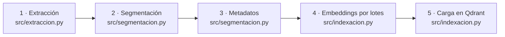

# Fase 2: Creación de la base de conocimiento

## 1. Identificación de documentos

Elegimos tres tipos de documentos que cubren casi todo el 80% de consultas repetitivas de EcoMarket. Cada uno tiene un **formato distinto a propósito**, porque así es en una empresa real y porque cada formato exige un tratamiento diferente al extraerlo y segmentarlo.

| # | Documento | Formato | Archivo | Qué preguntas responde |
|---|---|---|---|---|
| 1 | **Políticas de servicio**: devoluciones, envíos, garantías, medios de pago y privacidad | PDF (4 páginas, 5 políticas, 23 subsecciones) | `data/documentos/politicas_ecomarket.pdf` | "¿Puedo devolver un champú?", "¿Cuánto cuesta el envío?", "¿La garantía cubre caídas?" |
| 2 | **Catálogo e inventario de productos** | Hoja de cálculo CSV (18 productos) | `data/documentos/catalogo_inventario.csv` | "¿Qué puertos tiene el panel solar?", "¿Hay miel disponible?", "¿Cuánto cuesta la mochila?" |
| 3 | **Preguntas frecuentes** | JSON (13 pares pregunta-respuesta) | `data/documentos/preguntas_frecuentes.json` | "¿Tienen tienda física?", "¿Cuál es el horario?", "¿Venden al por mayor?" |

### ¿Y los pedidos? Por qué NO van en la base vectorial

Los pedidos (`data/pedidos.json`) se dejan **fuera** del RAG a propósito, por tres razones:

1. **Cambian constantemente.** El estado de un pedido cambia varias veces al día; mantener esos vectores actualizados sería costoso y siempre habría un desfase.
2. **La búsqueda por similitud es la herramienta equivocada.** Los textos de los pedidos ECO-10005 y ECO-10006 son casi idénticos como texto, pero pertenecen a personas distintas. Una búsqueda "por parecido" podría devolverle a un cliente el pedido de otro. Lo correcto es una búsqueda **exacta** por número.
3. **Privacidad.** Son datos personales; no deben quedar mezclados en un índice que consulta cualquier conversación.

Por eso, igual que en el Taller 1, los pedidos se consultan con una **herramienta** (`src/herramientas.py`), y el RAG se reserva para el conocimiento que es igual para todos los clientes.

### La calidad de los documentos importa tanto como el modelo

Un RAG solo puede ser tan bueno como lo que recupera. Al preparar los documentos cuidamos que:

- **Cada dato esté en un solo lugar.** Si la política dice "30 días" y una pregunta frecuente vieja dice "15 días", el modelo recibirá ambas y no sabrá cuál creer. Las preguntas frecuentes no repiten las políticas; las complementan.
- **Los documentos tengan estructura explícita** (títulos de política, subsecciones numeradas). Esa estructura se aprovecha en la segmentación y en los metadatos.
- **El texto sea autocontenido.** Por ejemplo, en la política se escribe "productos de higiene personal, como cepillos de dientes, champús y desodorantes", y no solo "categoría higiene_personal". Así una pregunta como "¿puedo devolver un desodorante?" se parece al fragmento correcto.
- **Cada documento tenga versión y fecha** (el PDF indica "Versión 3.2 · Vigente desde el 1 de septiembre de 2026"; el JSON tiene un campo `actualizado`), para saber cuándo reindexar.
- **Se eliminen elementos que no aportan**, como el encabezado repetido del PDF, que solo añadiría ruido a la búsqueda.

## 2. Segmentación (chunking)

### Por qué segmentar

No se puede vectorizar cada documento completo como un solo bloque: un vector que representa cuatro páginas de políticas "promedia" el significado de todo y no se parece a ninguna pregunta concreta. Además, meter documentos completos en el prompt llena el contexto del modelo de información irrelevante, y un modelo pequeño como `qwen3:4b` se distrae con facilidad. El objetivo es que **cada fragmento contenga una idea completa y nada más**.

### Estrategias evaluadas

| Estrategia | Cómo funciona | Ventaja | Problema para EcoMarket |
|---|---|---|---|
| **Tamaño fijo** | Corta cada N caracteres exactos | Simple y predecible | Corta palabras y oraciones a la mitad. Un dato como "5 a 7 días hábiles" puede quedar partido entre dos fragmentos y ninguno de los dos lo contiene completo |
| **Por párrafos** | Un fragmento por párrafo | Respeta las unidades de sentido del autor | Tamaños muy dispares: un párrafo de 30 caracteres ("Tarjetas regalo: no son reembolsables...") pierde el contexto de que habla de devoluciones, y uno muy largo mezcla varias ideas |
| **Recursiva** (`RecursiveCharacterTextSplitter`) | Intenta dividir por párrafos; si el bloque es muy grande, por líneas; luego por oraciones; luego por palabras. Mantiene un solapamiento (10–20%) entre fragmentos | Respeta los límites naturales del texto y controla el tamaño | Por sí sola no conoce la estructura del documento: un fragmento puede empezar al final de la política de devoluciones y terminar en la de envíos |
| **Estructural + recursiva** (elegida para el PDF) | Primero divide según la estructura del documento (política > subsección); solo si una subsección es muy larga, aplica la división recursiva | Fragmentos que nunca mezclan temas, con metadatos de sección para filtrar y citar | Requiere documentos con estructura reconocible (que es justo lo que cuidamos al prepararlos) |

### Estrategia elegida, por tipo de documento

La mejor estrategia **depende del tipo de documento**, así que no usamos una sola:

**Políticas (PDF, texto narrativo): estructural + recursiva**, con fragmentos de hasta **500 caracteres** y **75 de solapamiento (15%)**.

1. Cada subsección (1.1, 1.2, ...) se trata como una unidad. Así, el plazo de devoluciones nunca queda mezclado con los tiempos de envío.
2. Si una subsección supera 500 caracteres, `RecursiveCharacterTextSplitter` la divide probando, en orden: párrafo → línea → oración → punto y coma → coma → palabra. En la práctica, la subsección 1.2 (productos no retornables, 529 caracteres) se divide en dos fragmentos por un límite de párrafo, sin cortar ninguna oración.
3. Se mantiene un solapamiento del 15% para que una idea que cae justo en el borde aparezca completa en al menos uno de los dos fragmentos.
4. **A cada fragmento se le antepone un encabezado de contexto**, por ejemplo `[Política de devoluciones > 1.2 Productos que no se pueden devolver]`. Sin él, el segundo fragmento de la sección 1.2 diría solo "Tarjetas regalo: no son reembolsables una vez emitidas", sin aclarar que se trata de devoluciones. Con el encabezado, el fragmento se entiende solo y se parece más a las preguntas sobre devoluciones.

**¿Por qué 500 caracteres?** Las subsecciones del documento miden entre 112 y 529 caracteres, así que con 500 casi todas quedan completas en un solo fragmento y solo se dividen las excepcionalmente largas. Fragmentos de este tamaño contienen una sola idea, lo que hace la búsqueda más precisa, y permiten pasar 4 o 5 fragmentos al modelo sin saturar su contexto. BGE-M3 aceptaría entradas mucho más largas (8.192 tokens), pero que el modelo lo permita no significa que convenga: fragmentos grandes diluyen el significado del vector. El experimento 2 de la Fase 3 compara 150, 300, 500 y 1.000 caracteres.

**Catálogo (CSV) y preguntas frecuentes (JSON): un registro por fragmento.** Cada producto y cada par pregunta-respuesta ya es una unidad de sentido corta (124 a 542 caracteres). Partirlos sería contraproducente: se podría separar el precio de un producto de su nombre, o una pregunta de su respuesta. Solo se dividirían si un registro superara el doble del tamaño máximo, como medida de seguridad. Cada fila del CSV se convierte en un texto legible ("Producto: ... Precio: 320.000 pesos colombianos ... Se puede devolver: Sí"), porque el modelo de embeddings entiende mejor el lenguaje natural que una fila separada por comas.

### Resultado

| Documento | Unidades extraídas | Fragmentos |
|---|---|---|
| Políticas (PDF) | 23 subsecciones | 24 |
| Catálogo (CSV) | 18 productos | 18 |
| Preguntas frecuentes (JSON) | 13 pares | 13 |
| **Total** | | **55** (longitud promedio ~300 caracteres) |

## 3. Indexación

La indexación es el proceso de llevar los documentos desde sus archivos originales hasta la base vectorial, listos para ser buscados. La organizamos en cinco pasos; cada uno corresponde a un módulo del código:

**Paso 1 · Extracción.** Primero se identifica qué tipo de archivo es cada fuente, porque cada formato necesita un cargador distinto:
- PDF: `PyPDFLoader` de LangChain en modo `layout`, que conserva los saltos de párrafo. Luego se reconstruyen los párrafos (el PDF corta las líneas por ancho de página, no por sentido), se descarta el encabezado repetido y se detectan los títulos de política y las subsecciones numeradas.
- CSV: se lee cada fila con el módulo `csv` y se convierte en un `Document`.
- JSON: se recorre la lista de preguntas y se crea un `Document` por cada par.

El resultado es una lista de objetos `Document` de LangChain, cada uno con su texto (`page_content`) y sus metadatos (`metadata`).

**Paso 2 · Segmentación.** Se aplica la estrategia descrita arriba con `RecursiveCharacterTextSplitter`.

**Paso 3 · Enriquecimiento de metadatos.** Cada fragmento lleva información estructurada que permite filtrar, citar y mantener la base:

| Metadato | Ejemplo | Para qué sirve |
|---|---|---|
| `fuente` | `politicas_ecomarket.pdf` | Citar de dónde sale la respuesta |
| `tipo_documento` | `politica` / `producto` / `faq` | Filtrar por tipo |
| `tema` | `devoluciones`, `envios`, `garantias`, `productos`... | **Filtrar la búsqueda según el tema que detecta el orquestador** |
| `politica`, `seccion`, `titulo_seccion` | `Política de garantías`, `3.3`, `Qué no cubre la garantía` | Citar con precisión |
| `id_producto`, `categoria`, `precio_cop`, `stock`, `retornable` | `P09`, `tecnologia`, `320000`, `22`, `true` | Filtros estructurados (por ejemplo, solo productos disponibles) |
| `parte`, `total_partes` | `2`, `2` | Saber si un fragmento es parte de una sección dividida |
| `chunk_id` | `2d322a04d56b3892` | Identificador estable (hash del contenido) |
| `num_caracteres`, `fecha_indexacion` | `460`, `2026-10-15` | Control de calidad y mantenimiento |

**Paso 4 · Vectorización por lotes.** Los textos se envían al modelo BGE-M3 (servido por Ollama) en **lotes de 32**, en lugar de uno por uno, para reducir el número de llamadas y acelerar el proceso. Cada fragmento se convierte en un vector de **1024 números** que representa su significado.

**Paso 5 · Carga en Qdrant.** Se crea una colección configurada con vectores de 1024 dimensiones y **distancia coseno** (que compara la dirección de los vectores, es decir, el significado, sin importar la longitud del texto). Cada punto guarda tres cosas: el **vector**, el **texto original** del fragmento (que es lo que después se pasa al LLM) y sus **metadatos**. El identificador de cada punto se deriva del `chunk_id`, así que volver a indexar el mismo contenido lo actualiza en lugar de duplicarlo. En un servidor Qdrant, además, se crean índices sobre los campos `tipo_documento`, `tema` y `categoria` para que el filtrado sea rápido.

Todo el proceso se ejecuta con `python indexar.py`.

### Mantenimiento de la base

| Documento | Frecuencia de cambio | Estrategia de actualización |
|---|---|---|
| Políticas | Pocas veces al año | Reindexar cuando se publique una nueva versión del PDF |
| Preguntas frecuentes | Mensual | Reindexar cuando cambie la fecha `actualizado` |
| Catálogo (descripción, precio) | Semanal | Reindexación programada |
| Inventario (stock) | Varias veces al día | En producción, el stock exacto se consultaría con una herramienta en tiempo real; el dato del índice sirve como referencia con fecha de corte |

## 4. Cómo la calidad de esta fase afecta al sistema

| Si se hace mal... | ...el efecto en el RAG es |
|---|---|
| Documentos contradictorios o desactualizados | El modelo recibe datos en conflicto y responde de forma inconsistente |
| Extracción que mezcla encabezados o corta párrafos | Fragmentos con ruido que se parecen a todo y a nada |
| Fragmentos demasiado grandes | Vectores "promediados" que no coinciden con preguntas concretas, y prompts llenos de información irrelevante |
| Fragmentos demasiado pequeños o cortados a la mitad | Se recupera la mitad de un dato, o un fragmento sin contexto |
| Sin metadatos | Imposible filtrar por tema o citar la fuente; más respuestas con información del documento equivocado |
| Datos transaccionales en el índice vectorial | Respuestas desactualizadas y riesgo de mostrar datos de otro cliente |

En resumen: la búsqueda solo puede encontrar lo que esta fase dejó bien preparado.
