# Fase 3: Integración y ejecución del código

Este documento explica cómo está construido el sistema, qué hace cada sección del código, cómo se conectan las piezas y qué experimentos se hicieron modificando el código y los prompts. Las instrucciones de instalación están en el [README](../README.md).

## 1. Del Taller 1 al Taller 2: qué cambió

| Aspecto | Taller 1 | Taller 2 (este repositorio) |
|---|---|---|
| Conocimiento de la empresa | Pegado completo en el prompt (toda la política, todos los pedidos) | Recuperado de Qdrant: solo los fragmentos relevantes para cada pregunta |
| Alcance | Dos tipos de consulta (pedidos y devoluciones) | **Cualquier consulta**: políticas, productos, preguntas frecuentes, pedidos, devoluciones; y reconoce lo que no sabe |
| Documentos | Un JSON de pedidos y un Markdown de política | PDF de políticas, CSV de catálogo e inventario, JSON de preguntas frecuentes |
| Orquestador | Clasifica la intención | Además identifica el **tema** (para filtrar la búsqueda) y **reformula la pregunta** usando el historial |
| Devoluciones | El evaluador recibía la política completa | El evaluador recibe las secciones recuperadas por el RAG |
| Preguntas sin respuesta | El modelo podía improvisar | Umbral de relevancia: si nada en la base supera el umbral, responde "no tengo esa información" sin llamar al modelo |
| Framework | Llamadas directas a la librería `ollama` | LangChain (cargadores, segmentadores, embeddings, vector store y cadenas LCEL) |
| Se mantiene | Modelo `qwen3:4b`, herramienta de pedidos, cadena evaluador → redactor, escalamiento con ticket | |

## 2. Arquitectura

```mermaid
flowchart TD
    M[Mensaje del cliente] --> O["Orquestador (JSON)<br/>intención · temas · consulta reformulada · ¿humano?"]
    O -->|queja o pide una persona| H[Escalamiento → ticket con resumen]
    O -->|estado_pedido| T1[Herramienta consultar_pedido<br/>búsqueda exacta por número]
    T1 --> P[Prompt de pedido]
    O -->|devolucion| T2[Herramienta: hechos del caso<br/>días, categoría, producto]
    T2 --> R1[RAG filtrado:<br/>política de devoluciones y garantías]
    R1 --> EV[Evaluador JSON] --> RE[Redactor empático]
    O -->|consulta_informacion<br/>fuera_de_alcance| R2[RAG: buscar en Qdrant<br/>filtro por tema → respaldo sin filtro]
    R2 -->|similitud ≥ umbral| G[Prompt RAG con fuentes]
    R2 -->|nada relevante| N["'No tengo esa información'<br/>+ ofrecer agente humano"]
    O -->|saludo| S[Prompt general]
```



## 3. Recorrido por el código

### Estructura

```
src/
├── config.py        Parámetros (modelos, tamaño de chunk, k, umbral), configurables por variables de entorno
├── extraccion.py    Paso 1: PDF/CSV/JSON → Documents con metadatos
├── segmentacion.py  Pasos 2-3: chunking y metadatos (+ estrategias alternativas para experimentos)
├── indexacion.py    Pasos 4-5: embeddings bge-m3 y carga en Qdrant
├── recuperacion.py  Búsqueda por similitud, filtros, umbral y formato del contexto
├── herramientas.py  Consulta exacta de pedidos (datos transaccionales, sin RAG)
├── llm.py           Modelo de generación y construcción de cadenas LCEL
├── prompts.py       Todas las plantillas de prompts
└── asistente.py     Orquestador y rutas: une todas las piezas
indexar.py           Construye la base de conocimiento
buscar.py            Prueba solo la recuperación
chat_ecomarket.py    Chat completo
experimentos.py      Experimentos de modificación
```

### 3.1 Extracción (`src/extraccion.py`)

Cada tipo de documento tiene su función de carga. El PDF es el más delicado:

```python
paginas = PyPDFLoader(str(ruta), extraction_mode="layout").load()
```

El modo `layout` conserva los espacios verticales del PDF, así que los párrafos quedan separados por una línea en blanco. Sin él, todo el texto saldría como líneas continuas y la segmentación por párrafos no tendría de dónde agarrarse. Luego `cargar_politicas()` recorre los párrafos, detecta los títulos en mayúsculas ("POLÍTICA DE DEVOLUCIONES") y las subsecciones numeradas ("1.2 ...") y produce un `Document` por subsección con metadatos como `tema="devoluciones"` y `seccion="1.2"`.

El CSV y el JSON son más simples: `cargar_catalogo()` convierte cada fila en un texto legible y `cargar_faq()` crea un `Document` por cada par pregunta-respuesta.

### 3.2 Segmentación y metadatos (`src/segmentacion.py`)

```python
RecursiveCharacterTextSplitter(
    chunk_size=500, chunk_overlap=75,
    separators=["\n\n", "\n", ". ", "; ", ", ", " ", ""],
    keep_separator="end",
)
```

La lista `separators` es el corazón de la segmentación recursiva: el splitter intenta cortar por el primer separador (párrafo); si el fragmento sigue siendo mayor que `chunk_size`, pasa al siguiente (línea, oración...). `keep_separator="end"` deja el punto al final de la oración que cierra, en lugar de al inicio de la siguiente.

`segmentar_politicas()` aplica el splitter **dentro** de cada subsección y antepone el encabezado `[Política > sección]`. `segmentar_registros()` deja completos los productos y las preguntas frecuentes. `enriquecer_metadatos()` agrega `chunk_id` (hash del contenido), longitud y fecha.

### 3.3 Embeddings y base vectorial (`src/indexacion.py`)

Aquí se conectan las dos piezas elegidas en la Fase 1:

```python
embeddings = OllamaEmbeddings(model="bge-m3")                 # modelo de embeddings
cliente = QdrantClient(path="qdrant_data")                     # Qdrant en modo local
cliente.create_collection(coleccion, vectors_config=VectorParams(size=1024, distance=Distance.COSINE))
almacen = QdrantVectorStore(client=cliente, collection_name=coleccion, embedding=embeddings)
almacen.add_documents(fragmentos, ids=ids, batch_size=32)      # vectoriza por lotes y carga
```

`QdrantVectorStore` es el puente de LangChain: al llamar `add_documents`, toma el texto de cada fragmento, pide su vector a `OllamaEmbeddings` y guarda en Qdrant el vector junto con el texto y los metadatos. La dimensión de la colección no se escribe a mano: se calcula vectorizando un texto de prueba, así el código sigue funcionando si se cambia de modelo de embeddings.

Si se define la variable `QDRANT_URL`, el mismo código se conecta a un servidor Qdrant (Docker o Qdrant Cloud) en lugar del modo local.

### 3.4 Recuperación (`src/recuperacion.py`)

```python
pares = almacen.similarity_search_with_score(consulta, k=k, filter=construir_filtro(temas))
```

En cada consulta, `QdrantVectorStore` vectoriza la pregunta con **el mismo modelo** (si se usara otro, los vectores no serían comparables) y Qdrant devuelve los `k` fragmentos más cercanos con su similitud coseno. `recuperar()` agrega tres decisiones:

1. **Filtro por tema**: si el orquestador dijo que la pregunta es de "envíos", busca solo en fragmentos con `metadata.tema = envios`.
2. **Respaldo sin filtro**: si con el filtro el mejor resultado no supera el umbral (porque el orquestador se equivocó de tema), repite la búsqueda en toda la base.
3. **Umbral de relevancia** (0,45 por defecto): descarta los fragmentos poco parecidos. Si no queda ninguno, el asistente sabe que **no tiene la información**.

`formatear_contexto()` numera los fragmentos (`[1] Fuente: politicas_ecomarket.pdf · Política de envíos, sección 2.3`) para que el modelo pueda citarlos.

### 3.5 Generación y cadenas (`src/llm.py` y `src/prompts.py`)

Las cadenas usan la sintaxis LCEL de LangChain, donde `|` conecta pasos:

```python
cadena = prompt | ChatOllama(model="qwen3:4b") | StrOutputParser()
cadena.invoke({"contexto": contexto_recuperado, "pregunta": pregunta})
```

`ChatPromptTemplate` rellena las variables `{contexto}` y `{pregunta}`; el modelo genera; el parser devuelve texto. Las cadenas que deben devolver datos (orquestador, evaluador, escalamiento) usan el modo JSON de Ollama y un parser que convierte la respuesta en diccionario.

El prompt principal (`RAG_RESPUESTA`) aplica las técnicas del Taller 1 adaptadas al RAG: rol definido, anclaje estricto ("usa EXCLUSIVAMENTE la información de `<contexto>`"), instrucción explícita de reconocer cuando la respuesta no está, prohibición de inventar, ignorar el contexto irrelevante y citar las fuentes usadas.

### 3.6 El asistente (`src/asistente.py`)

`AsistenteEcoMarket.responder()` es donde todo se une:

1. **Clasifica** el mensaje con el orquestador. El orquestador también **reformula la consulta** con el historial: si el cliente pregunta "¿y ese tiene garantía?", la búsqueda se hace con "¿El cargador solar tiene garantía?". Sin esto, el RAG buscaría la palabra "ese" y no encontraría nada útil.
2. **Enruta** según la intención (ver el diagrama). Las consultas generales y las "fuera de alcance" siempre pasan por el RAG: si el orquestador se equivoca al clasificar algo como fuera de alcance, la base de conocimiento todavía tiene la oportunidad de responder.
3. En **devoluciones**, combina la herramienta (días desde la entrega y categoría, calculados en Python) con el RAG (secciones de la política filtradas por tema), y luego aplica la cadena evaluador → redactor del Taller 1.
4. Guarda el **historial** para las siguientes preguntas.

## 4. Cómo ejecutarlo

```bash
ollama pull qwen3:4b && ollama pull bge-m3
pip install -r requirements.txt
python indexar.py --mostrar 3          # construye la base de conocimiento
python buscar.py "¿puedo devolver un champú?"
python chat_ecomarket.py --debug       # chat mostrando clasificación y fuentes
python chat_ecomarket.py --demo        # conversación de prueba → resultados/chat_demo.md
python experimentos.py                 # experimentos → resultados/experimento_N.md
```

## 5. Experimentos: modificar y observar

Para demostrar cómo cada pieza afecta el comportamiento, `experimentos.py` cambia una sola variable a la vez y compara.

### Experimento 1 · Sin RAG vs. con RAG

**Qué se modifica:** el prompt recibe o no los fragmentos recuperados. Mismo modelo, misma pregunta, misma temperatura.

**Qué se espera:** sin RAG, el modelo no conoce los datos de EcoMarket, así que inventa (por ejemplo, un plazo de devolución "típico" de 15 días) o responde de forma vaga. Con RAG, responde con el dato exacto y cita la fuente.

### Experimento 2 · Estrategias de segmentación

**Qué se modifica:** cómo se divide el PDF de políticas (tamaño fijo, párrafos, recursiva, estructural + recursiva) y el tamaño de los fragmentos (150, 300, 500 y 1.000 caracteres).

**Cómo se mide:** 14 preguntas con la frase exacta que contiene la respuesta. Un acierto significa que la frase aparece **completa** en alguno de los fragmentos recuperados (acierto@1, acierto@3 y MRR). No interviene el LLM: se evalúa solo la recuperación, que es lo que la segmentación afecta.

**Qué se espera:** el tamaño fijo debería fallar en preguntas cuya respuesta queda partida por un corte (el reporte muestra un ejemplo real de corte a mitad de oración). Los párrafos sueltos deberían perder contexto. La estrategia estructural debería ser al menos tan buena como la recursiva simple, y además aporta metadatos de tema y sección para filtrar y citar.

### Experimento 3 · Prompt estricto vs. permisivo

**Qué se modifica:** el prompt y el umbral. El estricto usa reglas de anclaje y umbral de relevancia; el permisivo dice solo "usa este contexto como ayuda" y siempre recibe los 4 fragmentos más parecidos, aunque no tengan relación con la pregunta.

**Qué se espera:** con preguntas que no están en la base ("¿tienen descuento para estudiantes?"), el permisivo tiende a improvisar o a forzar una respuesta con fragmentos que no vienen al caso; el estricto reconoce que no tiene la información y ofrece un agente humano. La pregunta de control (que sí está en la base) debería responderse bien con ambos.

### Otras modificaciones fáciles de probar

Todos los parámetros se cambian con variables de entorno, sin tocar el código:

```bash
CHUNK_SIZE=300 CHUNK_OVERLAP=45 python indexar.py   # otro tamaño de chunk (hay que reindexar)
RAG_K=2 python chat_ecomarket.py --debug             # menos fragmentos en el contexto
RAG_UMBRAL=0.6 python chat_ecomarket.py --debug      # umbral más exigente
OLLAMA_MODEL=qwen3:8b python experimentos.py 1       # modelo de generación más grande
```

## 6. Resultados y análisis

**Experimento 1 (sin RAG vs. con RAG):** la comparación muestra una diferencia muy clara entre cómo trabaja el modelo con y sin RAG: sin RAG acertó solo 1 de las 5 preguntas, y en las otras 4 alucinó con mucha confianza porque no tiene la información de EcoMarket y aun así responde como si la tuviera. Por ejemplo, inventó que el envío es gratis desde $50.000 (el dato real es $150.000), que el panel solar cuesta "$350 COP" y que sí se acepta pago contra entrega, cuando la política dice justo lo contrario. Con RAG, en cambio, acertó las 5 de 5 y además citó la fuente del fragmento usado. Esto demuestra que el problema no es que el modelo "no sepa responder": es que sin contexto no tiene con qué responder bien, y lo compensa inventando. El RAG soluciona ese problema dándole al modelo la información real antes de generar la respuesta.

**Experimento 2 (estrategias de segmentación):** aquí se ve justo el problema de cortar los documentos a la mitad. Con tamaño fijo, la información queda partida entre un fragmento y el siguiente (el ejemplo del reporte corta literalmente la frase "el cliente puede" de "cancelarlo sin costo"), así que ninguno de los dos fragmentos contiene la idea completa y la búsqueda trae un resultado incompleto. Esto se refleja en los números: tamaño fijo obtuvo 86% de acierto@1 y por párrafos solo 79%, mientras que la estrategia elegida (estructural + recursiva) llegó a 100% de acierto@1 y MRR de 1.00, es decir, siempre trajo el fragmento correcto en el primer lugar. Al comparar tamaños de fragmento (150, 300, 500 y 1.000 caracteres) los cuatro dieron el mismo resultado perfecto; esto se debe a que la base de conocimiento actual es pequeña (24 fragmentos de políticas), así que a esta escala el tamaño del chunk no alcanza a notarse en la búsqueda. Aun así, la estructura por sección sigue siendo la mejor opción porque no depende de la suerte del corte: cada fragmento respeta un tema completo y además trae metadatos (política, sección) que permiten filtrar y citar, algo que ninguna de las otras estrategias ofrece.

**Experimento 3 (prompt estricto vs. permisivo):** el caso más claro es la pregunta "¿Cuál es la capital de Australia?", que no tiene nada que ver con EcoMarket: la mejor similitud encontrada fue 0.260, muy por debajo del umbral de 0.45. El prompt estricto, al no superar el umbral, responde directamente "no tengo información" sin llamar al modelo. El prompt permisivo, en cambio, igual recibe los 4 fragmentos más parecidos (aunque no tengan relación) y el modelo inventa una respuesta — en este caso una respuesta que incluso se contradice a sí misma ("Australia no tiene capital... su capital es Canberra"). Esto confirma que el umbral sí está separando bien los dos grupos: la pregunta de control, que sí está en la base ("¿Los productos de higiene personal se pueden devolver?"), obtuvo una similitud de 0.740, muy por encima del umbral. El experimento muestra que un sistema RAG necesita las dos piezas, no solo el contexto recuperado: un umbral de relevancia y un prompt que lo respete son los que evitan que el modelo responda de un tema para el que no tiene información real.

**Chat de demostración:** la reformulación de preguntas usando el historial funcionó correctamente en los dos casos de prueba. "¿Y desde qué valor es gratis?" se reformuló como "¿Desde qué valor es gratis el envío en EcoMarket?", manteniendo el tema de la conversación anterior sobre envíos. "¿Ese tiene garantía?" se reformuló como "¿Cuánto tiempo de garantía tiene el cargador solar con batería de 10.000 mAh?", identificando correctamente a qué producto se refería "ese" a partir del mensaje anterior. Sin esta reformulación, el RAG habría buscado literalmente la palabra "ese" y no habría encontrado nada útil. Como limitación honesta: en la pregunta sobre una recomendación de película, el orquestador clasificó mal la intención (la marcó como "saludo" en lugar de "fuera_de_alcance"), así que nunca pasó por el RAG y el modelo del chat general inventó un título de película inexistente. Esto muestra que la calidad del sistema RAG depende también de que el orquestador clasifique bien la intención: si se equivoca antes de llegar al RAG, ni la mejor base de conocimiento puede ayudar.

En conjunto, los tres experimentos y la demo muestran que el RAG es un cambio de fondo en cómo funciona el modelo: deja de depender de lo que "recuerda" (y de lo que inventa cuando no recuerda) y pasa a buscar la información real antes de responder. Pero también se ve que el RAG no funciona solo: necesita una buena segmentación (para que la información no quede cortada), un umbral de relevancia (para saber cuándo no tiene información) y una buena clasificación de intención (para llegar al RAG cuando corresponde).
